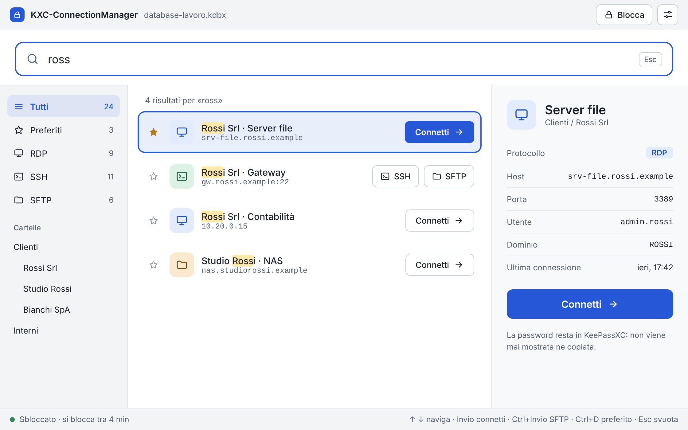
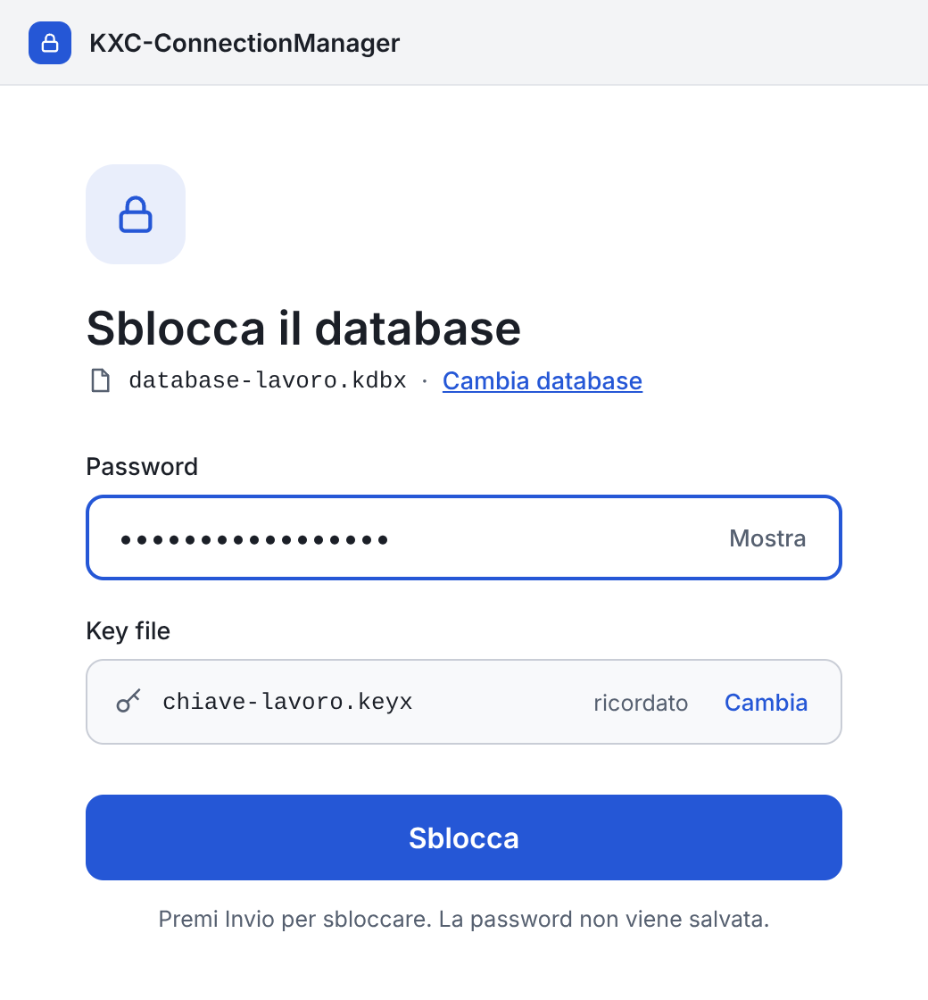
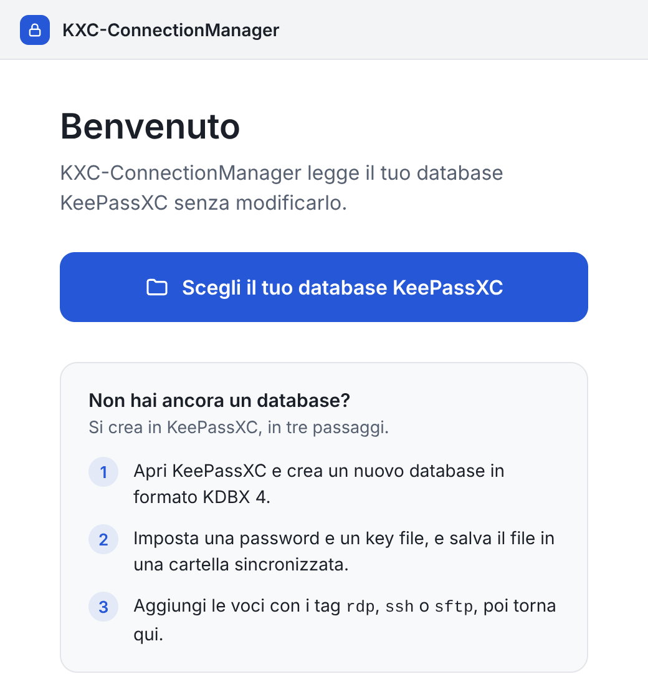
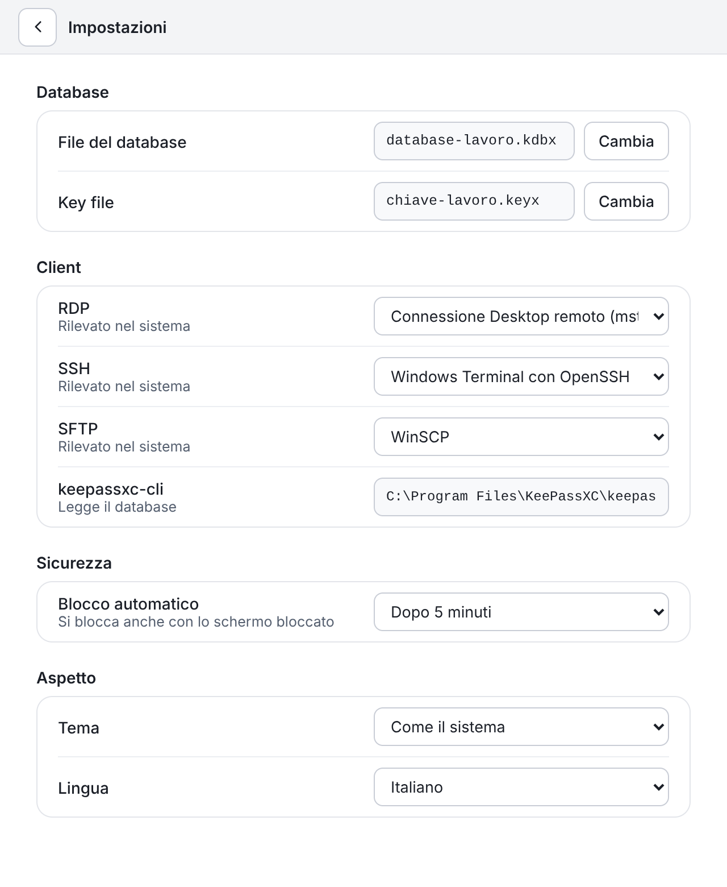
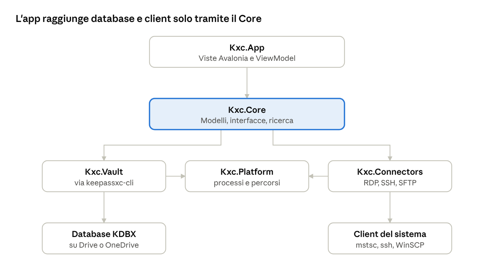

# Specifiche - KXC-ConnectionManager

Oct 16, 2026 · @Fabio

## Panoramica e obiettivi

KXC-ConnectionManager è un'app desktop open source (licenza GNU AGPL v3) per Windows 11 e Linux che legge un database KeePassXC già esistente e avvia con un click sessioni RDP, SSH e SFTP, senza duplicare nessuna credenziale.

**Problema.** Oggi password manager e client di connessione sono due mondi separati: ogni client (mRemoteNG, Bitvise, WinSCP) salva le password a modo suo, e le credenziali vanno gestite due volte.

**Obiettivi**

1. Un solo archivio di credenziali: il file `.kdbx` di KeePassXC.
2. Dall'elenco alla sessione attiva con un click o con Invio.
3. Nessun segreto scritto su disco, nei log o nei parametri dei comandi.
4. Stessa app e stesso database su Windows e Kubuntu (dual boot).
5. Primo utilizzo senza manuale: l'app si spiega da sola.

**Cosa non è**

- Non è un password manager: non crea né modifica voci nell'MVP, e non implementa crittografia propria.
- Non è un client RDP o SSH integrato: avvia i client già installati nel sistema.
- Non è uno strumento per team: nessun server, nessuna condivisione, nessun account.

## Principi di design: la semplicità viene prima di tutto

Ogni scelta di interfaccia e di funzionalità si misura su una domanda: rende più rapida e più ovvia la connessione a un host? Se no, non entra nell'MVP.

**Regole concrete**

- **Ricerca come interfaccia principale.** Il campo di ricerca ha sempre il focus. Si digita, la lista si filtra mentre si scrive, Invio connette.
- **Zero configurazione iniziale.** Al primo avvio un solo passo: scegliere il file `.kdbx` (e il key file, se c'è). Tutto il resto parte con valori predefiniti sensati.
- **Mai la stessa richiesta due volte.** La master password si chiede una volta per sessione di sblocco, mai per ogni connessione.
- **Un modo evidente per fare ogni cosa.** Un pulsante di connessione per protocollo, con il nome del protocollo; niente menu annidati, niente modalità nascoste.
- **Parole semplici.** «Connetti», «Sblocca», «Blocca». Nessun gergo tecnico nell'interfaccia (niente «invoke», «provider», «vault»).
- **Errori che spiegano e propongono.** Ogni errore dice cosa è successo e cosa fare («WinSCP non trovato. Installalo oppure scegli un altro client in Impostazioni»).
- **Tastiera e mouse alla pari.** Tutto si può fare con la tastiera, ma niente richiede di conoscere una scorciatoia.
- **Sicuro senza scegliere.** L'utente non deve configurare nulla per essere al sicuro: le impostazioni di sicurezza hanno valori già giusti.

**Obiettivi misurabili**

| Misura | Obiettivo |
| --- | --- |
| Dal primo avvio alla prima connessione | meno di 2 minuti, senza documentazione |
| Da database sbloccato a sessione avviata | al massimo 2 azioni, meno di 3 secondi |
| Impostazioni da toccare per iniziare | zero oltre al file del database |

## Utenti e scenari d'uso

L'utente tipo è un sistemista o professionista IT che gestisce molti host di clienti diversi, lavora su Windows e Linux in dual boot e vuole un solo punto dove stanno le credenziali.

1. **Avvio quotidiano.** Apre KXC-ConnectionManager, inserisce la master password, scrive «rossi», preme Invio: parte la sessione RDP sul server del cliente.
2. **Copia di file.** Seleziona una voce SSH e sceglie «Apri SFTP» per aprire il client di trasferimento sullo stesso host.
3. **Cambio di sistema operativo.** Riavvia in Windows (o in Linux) e trova lo stesso database, la stessa lista e gli stessi preferiti.
4. **Nuovo host.** Lo aggiunge in KeePassXC con i tag `rdp`, `ssh` o `sftp`; KXC-ConnectionManager lo mostra alla successiva ricarica, senza altri passaggi.
5. **Database aggiornato dalla sincronizzazione.** Il file su Google Drive o OneDrive cambia: KXC-ConnectionManager se ne accorge e ricarica l'elenco senza richiedere di nuovo la password.

## Requisiti funzionali

L'MVP comprende i requisiti da FR-01 a FR-12; gli altri sono rimandati alla versione 2.

| ID | Requisito | Fase |
| --- | --- | --- |
| FR-01 | Aprire un database KDBX 4 con password, key file o entrambi | MVP |
| FR-02 | Ricordare il percorso del database e del key file, mai la password | MVP |
| FR-03 | Bloccare l'app dopo inattività in KXC-ConnectionManager (predefinito 5 minuti), al blocco dello schermo e alla sospensione; il blocco non chiude le sessioni già avviate | MVP |
| FR-04 | Mostrare le voci con tag `rdp`, `ssh` o `sftp`, raggruppate per cartella del database | MVP |
| FR-05 | Ricerca istantanea su titolo, host, tag e note | MVP |
| FR-06 | Avviare una sessione RDP con doppio click o Invio | MVP |
| FR-07 | Avviare una sessione SSH con chiave dall'agente o con password | MVP |
| FR-08 | Avviare una sessione SFTP, anche dalla voce di un host SSH | MVP |
| FR-09 | Preferiti e connessioni recenti in cima alla lista | MVP |
| FR-10 | Mostrare lo stato della connessione (avvio in corso, errore) con messaggi chiari | MVP |
| FR-11 | Ricaricare l'elenco quando il file del database cambia, senza richiedere di nuovo la password | MVP |
| FR-12 | Impostazioni minime: client da usare, tempo di blocco, tema, lingua | MVP |
| FR-13 | Creare e modificare voci da KXC-ConnectionManager | v2 |
| FR-14 | Avviare più connessioni da una selezione | v2 |
| FR-15 | Esportare un report diagnostico privo di segreti | v2 |
| FR-16 | Salto tramite jump host SSH e RDP Gateway | v2 |
| FR-17 | Scorciatoia globale per richiamare la finestra | v2 |

## Interfaccia utente (Avalonia)

L'interfaccia ha due schermate e una pagina di impostazioni. Il tema segue quello del sistema (chiaro o scuro) usando il tema Fluent di Avalonia.

### Schermata di sblocco

- Mostra il database già scelto (percorso accorciato), un campo password e il pulsante «Sblocca».
- Il key file è un campo opzionale, ricordato dopo il primo uso. Dal secondo avvio basta la password.
- Al primo avvio compare un solo passo: «Scegli il tuo database KeePassXC». Se non esiste ancora, un breve testo spiega come crearlo in KeePassXC.
- Invio sblocca. Una password errata mostra un messaggio accanto al campo, senza finestre di dialogo.

### Finestra principale

- **In alto, una sola barra** (decisione del 22 ottobre 2026; il nome dell'app è già nella barra del titolo): da sinistra, icona e nome del database (largo quanto la colonna dei filtri, percorso completo nel suggerimento), campo di ricerca grande sempre a fuoco con il segnaposto «Cerca un host o un cliente», pulsante «Blocca», pulsante Impostazioni. Sblocco e primo avvio non hanno barre interne. Mockup delle alternative in `Docs/mockups/layout`.
- **A sinistra, stretta:** filtri «Tutti», «Preferiti», «RDP», «SSH», «SFTP» e, sotto, le cartelle del database.
- **Al centro:** lista delle voci. Ogni riga ha icona del protocollo, titolo, host, stella per il preferito e un pulsante di connessione per ciascun protocollo della voce. Il pulsante porta sempre il nome del protocollo («RDP», «SSH», «SFTP»), anche quando la voce ne ha uno solo (decisione del 22 ottobre 2026).
- **Protocollo predefinito.** Invio e doppio click avviano il protocollo con priorità più alta tra quelli della voce: RDP, poi SSH, poi SFTP. Ctrl+Invio apre sempre SFTP.
- **Ordinamento.** Senza ricerca: preferiti e recenti in cima, poi le voci raggruppate per cartella. Con una ricerca attiva, preferiti e recenti vengono ignorati e la lista è ordinata solo per pertinenza. La ricerca è sempre globale (decisione del 22 ottobre 2026): appena si scrive, il filtro a sinistra torna su «Tutti»; scegliere un filtro o una cartella svuota la ricerca.
- **A destra, opzionale:** dettaglio breve della voce selezionata (host, utente, protocollo, ultima connessione), con gli stessi pulsanti per protocollo della lista. Nessuna password visibile.
- **In basso:** barra di stato con lo stato del database («Sbloccato», «Si blocca tra 4 min») e l'esito dell'ultima connessione.

### Scorciatoie

| Azione | Tasti |
| --- | --- |
| Cercare | si scrive subito, il campo ha sempre il focus |
| Spostarsi nella lista | frecce su e giù |
| Connettersi | Invio |
| Aprire SFTP della voce selezionata | Ctrl+Invio |
| Segnare come preferito | Ctrl+D |
| Svuotare la ricerca | Esc |
| Bloccare | Ctrl+L |
| Impostazioni | Ctrl+virgola |

### Impostazioni

Una sola pagina, con quattro gruppi: database (percorso e key file), client (RDP, SSH, SFTP, rilevati in automatico), sicurezza (tempo di blocco) e aspetto (tema, lingua). Ogni voce ha un valore predefinito e una riga di spiegazione.

### Qualità dell'interfaccia

- Dimensione minima della finestra 720×480, dimensione e posizione ricordate.
- Scalatura corretta con DPI alto e frazionario, sia su Windows sia su Linux.
- Contrasto e dimensioni dei caratteri conformi a WCAG AA; ordine di tabulazione coerente e proprietà di automazione per i lettori di schermo.
- Lingue: italiano e inglese, con le stringhe in file di risorse.

### Mockup delle schermate

Le immagini seguenti mostrano il risultato atteso dell'interfaccia. Sono anteprime statiche con dati di esempio (clienti e host inventati): font e colori sono indicativi. La versione modificabile è nel [canvas dei mockup](https://claude.ai/artifact/DotJKGffKf16rf7ZNMhrrL), visibile solo al proprietario finché non viene condiviso.

**Finestra principale.** Ricerca sempre a fuoco, filtri a sinistra, lista con un pulsante per ogni protocollo e dettaglio della voce a destra. Copre FR-04, FR-05, FR-06, FR-07, FR-08 e FR-09.



**Sblocco.** Un campo password e il key file ricordato dopo il primo uso. Copre FR-01 e FR-02.



**Primo avvio.** Un solo passo, con le istruzioni brevi per creare il database in KeePassXC.



**Impostazioni.** Una sola pagina con i quattro gruppi: database, client, sicurezza e aspetto. Copre FR-12.



## Architettura e stack

L'app è in C# con .NET 10 (LTS) e Avalonia UI 12, con pattern MVVM. Un solo codice sorgente produce le build per Windows e Linux.



L'interfaccia raggiunge il database e i client di sistema solo attraverso il Core; le parti specifiche del sistema operativo restano in Platform.

**Stack**

- Interfaccia: Avalonia UI 12 con tema Fluent, MVVM con CommunityToolkit.Mvvm.
- Iniezione delle dipendenze con `Microsoft.Extensions.DependencyInjection`.
- Accesso al database KDBX tramite keepassxc-cli (scelta fissata, vedi sotto), dietro un'interfaccia `IVaultService`.
- Nessun altro pacchetto di rete o di telemetria: l'app non apre connessioni da sé.

**Moduli**

| Progetto | Responsabilità |
| --- | --- |
| `Kxc.App` | Viste e ViewModel Avalonia, navigazione, localizzazione |
| `Kxc.Core` | Modelli (`ConnectionEntry`), interfacce, regole di business, ricerca |
| `Kxc.Vault` | Sessione di keepassxc-cli, lettura delle voci, osservazione del file |
| `Kxc.Connectors` | Un connettore per protocollo (RDP, SSH, SFTP) con strategie per sistema operativo |
| `Kxc.Platform` | Parti specifiche del sistema: processi, blocco schermo, percorsi di configurazione |
| `Kxc.Tests` | Test unitari, di integrazione e di sicurezza |

**Regole di dipendenza.** `Core` non dipende da nessun altro progetto. `App` conosce `Core` e usa `Vault` e `Connectors` solo tramite interfacce. Il codice specifico di un sistema operativo vive solo in `Platform` e `Connectors`.

**Scelta: `keepassxc-cli` come motore di accesso al database.** KXC-ConnectionManager usa solo comandi di lettura di `keepassxc-cli` (`export`, `show`, `attachment-export`), un processo per operazione. Vantaggi: è la stessa implementazione di KeePassXC, quindi la compatibilità con KDBX 4, key file e campi personalizzati è piena, e non c'è nessuna libreria di terzi da verificare e mantenere. Costi: KeePassXC deve essere installato, l'output va letto come testo e i segreti passano dai canali stdin e stdout del processo.

**Modalità di esecuzione.** ~~Sessione unica `open` come predefinita~~: sostituita dopo la fase 0 da un processo `keepassxc-cli` per operazione (vedi sotto). La password del database resta in memoria in un buffer azzerabile finché l'app è sbloccata e viene passata da stdin a ogni comando. Ogni comando ripete la derivazione della chiave: circa 0,8 secondi sul database reale.

L'accesso resta dietro l'interfaccia `IVaultService`, così in futuro si può sostituire con una libreria .NET senza toccare il resto. Una libreria nativa si prova nella fase 0 solo come alternativa da confrontare.

**Esito della prova di fase 0 su Windows 11 (keepassxc-cli 2.7.12, 17 ottobre 2026).** Prove fatte con `TestData/testDB.kdbx` e con la fixture `tests/Fixtures/fixture.kdbx` (tag misti, campi personalizzati, voci scadute, Cestino, allegato, caratteri speciali).

- **Sessione `open` scartata come modalità predefinita.** Su Windows i caratteri non ASCII inviati sullo stdin della sessione vengono persi («Contabilità» diventa «Contabilit» e la voce non si trova). Il prompt è `<Nome database>> `, quindi non è un delimitatore fisso. Gli errori arrivano solo come testo localizzato su stderr, senza exit code per comando. Gli apici singoli nei percorsi falliscono senza errore. `export` non esiste dentro la sessione.
- **Nuova modalità predefinita: un processo per operazione.** Allo sblocco e a ogni ricarica: `export -q -f xml`, letto in streaming senza mai materializzare i valori protetti. Alla connessione: `show -q -s -a Password <percorso>`. Per la chiave SSH, se servirà: `attachment-export --stdout`. La password del database passa sempre da stdin, il percorso della voce come argomento della lista (niente quoting, niente iniezione, Unicode corretto). Costo misurato: circa 0,8 s per comando sul database reale (Argon2d, 46 cicli, 64 MB), dentro l'obiettivo dei 3 secondi.
- **Dati utili dall'export XML:** UUID (lo stesso mostrato da `show`), tag separati da virgola, gruppi annidati, `Expires`/`ExpiryTime`, `RecycleBinUUID`, allegati. Le voci della cronologia (`History`) vanno ignorate.
- `show` non accetta l'UUID, solo il percorso. Due voci con lo stesso percorso sono ambigue: la connessione va bloccata con un messaggio.
- Un attributo vuoto in `show -a` non stampa nessuna riga: non si leggono mai i valori per posizione.
- Password errata e key file mancante: exit code 1 e stderr vuoto con `-q`. Voce inesistente: exit code 1 con messaggio localizzato.
- `db-create` e `import` di keepassxc-cli 2.7.12 creano solo database KDBX 3.1 con AES-KDF, senza opzioni per KDBX 4 o Argon2: la fixture KDBX 4 dei test va creata nella GUI di KeePassXC (vedi `tests/Fixtures/README.md`). I database personali di prova stanno in `TestData/`, escluso dal repository.

**Esito della prova precedente (keepassxc-cli 2.7.6, database con password e key file).** Funzionano `ls -R -f -q`, `show -a <campo>` per tag e campi personalizzati e `show -s -a Password`, anche con caratteri speciali. Regole per il parser: usare sempre `-q`; i tag in `show` sono separati da virgola; le voci scadute compaiono in `ls` e vanno filtrate; le note si leggono con `show -a Notes`; password errata e key file non fornito danno lo stesso errore (exit code 1). Nella sessione `open` il prompt ` Passwords>  ` arriva su stdout senza a capo, insieme al comando riecheggiato, e gli errori su stderr: il parser usa il prompt come delimitatore tra una risposta e l'altra. **Ancora da verificare:** comportamento con KeePassXC 2.7.0 e con l'ultima versione stabile, e gestione di un processo che termina in modo inatteso.

## Integrazione con il database KeePassXC

KXC-ConnectionManager legge il database in sola lettura e non lo modifica mai nell'MVP: così non può creare conflitti con la sincronizzazione su Google Drive o OneDrive né con KeePassXC aperto in parallelo.

**Formato e sblocco**

- Formati supportati: KDBX 4 (consigliato: cifratura AES-256 o ChaCha20, derivazione Argon2) e KDBX 3.1, entrambi gestiti in modo trasparente da keepassxc-cli. Altri formati vengono rifiutati con un messaggio chiaro.
- Sblocco con password, key file o entrambi. Le credenziali di sblocco restano in memoria solo finché il database è sbloccato e vengono azzerate al blocco.
- La password viene passata a keepassxc-cli solo da stdin, mai come argomento; il database aperto e le credenziali di sblocco non vengono mai scritti su disco.

**Cambi del file (realizzato il 22 ottobre 2026).** Si osserva la cartella e non solo il file, perché KeePassXC salva con un rename; un controllo ogni 10 secondi copre i filesystem virtuali che non generano eventi; il cambio si segnala quando dimensione e data restano uguali per 2 secondi. La ricarica ritenta fino a 5 volte a 3 secondi di distanza; se le credenziali non valgono più (password o key file cambiati), l'app si blocca e lo dice. Il file viene osservato; se cambia mentre l'app è sbloccata, l'elenco si ricarica in modo trasparente: KXC-ConnectionManager rilegge il database con le credenziali già in memoria. Se il file è in uso o incompleto (sincronizzazione in corso), l'app ritenta dopo un breve intervallo e mostra lo stato nella barra in basso.

**Convenzioni sulle voci.** KXC-ConnectionManager non richiede un formato speciale: usa campi standard di KeePassXC e pochi campi personalizzati.

| Elemento | Dove si imposta | Significato |
| --- | --- | --- |
| Tag `rdp`, `ssh`, `sftp` | Tag della voce | Protocolli disponibili per la voce; se ne possono avere più di uno. Maiuscole e minuscole sono indifferenti (`RDP` = `rdp`) |
| Titolo | Campo standard | Nome mostrato nell'elenco e usato dalla ricerca |
| Nome utente e password | Campi standard | Credenziali dell'host |
| Host | Campo personalizzato `Host`; in assenza, l'host dell'URL | Indirizzo da raggiungere |
| Porta | Campo personalizzato `Port` | Facoltativa, con valori predefiniti 3389, 22, 22 |
| Dominio | Campo personalizzato `Domain` | Solo RDP, facoltativo |
| Chiave SSH | Allegato della voce, gestito dall'agente SSH di KeePassXC | Autenticazione senza password |

**Regole di lettura**

- Le voci nel Cestino e quelle scadute non vengono mostrate.
- Una voce senza host valido compare nell'elenco con un'avvertenza, non scompare in silenzio.
- I campi protetti (password, chiavi) vengono letti solo nel momento della connessione e rilasciati subito dopo.

### Creazione del database (prima configurazione)

Il database non esiste ancora: si crea in KeePassXC prima di usare KXC-ConnectionManager, che nell'MVP non lo crea.

1. Creare un nuovo database con l'ultima versione stabile di KeePassXC, in formato KDBX 4.
2. Impostare password e key file; conservare il key file fuori dal cloud (chiavetta o copia separata).
3. Lasciare le impostazioni di cifratura predefinite di KeePassXC, salvo esigenze diverse.
4. Salvare il file in una cartella sincronizzata con Google Drive o OneDrive.
5. Aggiungere una o due voci di prova con i tag e i campi descritti sopra: servono anche alla verifica della fase 0.
6. Se si usano chiavi SSH, attivare l'agente SSH di KeePassXC (vedi i connettori).

## Connettori RDP, SSH e SFTP

Ogni connettore implementa `IConnector` e lancia un client già installato. Tutti i processi partono tramite un unico `IProcessLauncher`, che riceve gli argomenti come lista (mai come stringa interpretata da una shell) e non registra mai segreti.

| Protocollo | Windows | Linux (Kubuntu) |
| --- | --- | --- |
| RDP | `mstsc` con file `.rdp` temporaneo; credenziali passate con `cmdkey` e rimosse subito dopo l'avvio | `xfreerdp` (FreeRDP); password passata da stdin, non come argomento |
| SSH | Windows Terminal con `ssh.exe` (OpenSSH); in alternativa PuTTY | Terminale predefinito (Konsole) con `ssh` |
| SFTP | WinSCP, configurabile | Dolphin (`sftp://`) o `sftp` in terminale, configurabile |

**Autenticazione SSH.** La scelta dipende dalla voce: se ha una chiave SSH allegata si usa l'agente, altrimenti la password. Il percorso preferito è la chiave nell'agente SSH di KeePassXC: KXC-ConnectionManager non vede mai la chiave privata. Per i server che accettano solo password si usa `SSH_ASKPASS` con un piccolo helper fornito da KXC-ConnectionManager, che riceve la password da un canale locale monouso. Non si usano mai argomenti di riga di comando né variabili d'ambiente con la password.

**Esito della prova di fase 0 per RDP su Windows (21 ottobre 2026, Windows 11, host in LAN con NLA).** Al posto di `cmdkey`, che riceve la password come argomento, KXC-ConnectionManager scrive la credenziale con l'API `CredWrite`: tipo `CRED_TYPE_DOMAIN_PASSWORD`, destinazione `TERMSRV/<host>`, persistenza `CRED_PERSIST_SESSION` (vale solo per la sessione di accesso a Windows e non viene salvata su disco). Il blob della password resta in un buffer bloccato e azzerato subito dopo. mstsc riceve solo `/v:<host>`. Esito: accesso senza richiesta della password, connessione TCP stabilita 0,44 s dopo l'avvio di mstsc (1,9 s dallo sblocco). La rimozione della credenziale 8 s dopo la connessione non interrompe la sessione. Il dominio scritto nel nome utente (`DOMINIO\utente`) funziona senza il campo Domain. Credential Guard non era attivo; con Credential Guard attivo la credenziale salvata non verrebbe usata e mstsc chiederebbe la password.

**Credenziali RDP.** ~~Su Windows le credenziali temporanee create con `cmdkey`~~ Su Windows le credenziali temporanee create con `CredWrite` vengono rimosse subito dopo l'avvio del client e, in ogni caso, alla chiusura di KXC-ConnectionManager. Su Linux la password viaggia solo su stdin verso FreeRDP; la sintassi esatta va verificata sulla versione installata nella fase 0.

**Rilevamento dei client.** Al primo avvio KXC-ConnectionManager cerca i client, e keepassxc-cli, nei percorsi standard e li propone come predefiniti. Il percorso di keepassxc-cli compare nelle impostazioni e non si usano eseguibili trovati in cartelle scrivibili da altri utenti. Se manca quello necessario, il messaggio d'errore indica cosa installare o dove scegliere un'alternativa. All'avvio controlla anche la versione di keepassxc-cli (con keepassxc-cli --version): se è inferiore alla 2.7.0, mostra un messaggio chiaro e non apre il database.

**Validazione degli input.** Host, porta, utente e dominio vengono validati prima del lancio (nome host o indirizzo IP valido, porta tra 1 e 65535, nessun carattere di controllo). Un valore non valido blocca la connessione con un messaggio chiaro.

**Esito della prova di fase 0 per SSH e SFTP su Windows (21 ottobre 2026, OpenSSH per Windows 9.5p2, Windows Terminal 1.25, server Raspbian con OpenSSH 7.9p1, prova con password fittizia).**

- Con `SSH_ASKPASS_REQUIRE=force` sia `ssh.exe` sia `sftp.exe` chiamano l'helper indicato in `SSH_ASKPASS`, anche senza `DISPLAY`.
- Le variabili d'ambiente arrivano a ssh anche quando è lanciato con `wt.exe -w new nt` e Windows Terminal è già aperto: il timore che la nuova scheda non le erediti non si è verificato su questa versione.
- Con `NumberOfPasswordPrompts=1` una password errata fa chiamare l'helper una sola volta e ssh termina con «Permission denied».
- **Rischio confermato:** la domanda sulla host key di un host mai visto («The authenticity of host…», su più righe) passa dallo stesso helper. Una risposta non valida fa ripetere a ssh «Please type 'yes', 'no' or the fingerprint» all'infinito (842 richieste in 40 secondi nella prova). L'helper deve quindi riconoscere le domande che non sono la password, non rispondere mai con la password e, in caso di dubbio, terminare con errore.
- WinSCP e PuTTY non sono installati sulla macchina di prova; il servizio ssh-agent di Windows è disattivato (predefinito di Windows).

**Esito con la password vera (21 ottobre 2026).** Prova con il connettore reale e l'helper `kxc-askpass`: SSH esegue un comando remoto, SFTP elenca la cartella home, la password viene consegnata una sola volta per avvio e non compare né negli argomenti né nell'ambiente (lì c'è solo il nome del canale). La domanda sulla host key arriva alla conferma con l'impronta letta correttamente.

- **Decisione (21 ottobre 2026): host key alla prima connessione con conferma nell'app.** L'helper inoltra la domanda all'app, che mostra una finestra con l'impronta; il pulsante a fuoco è «Annulla», quindi Invio non porta mai a fidarsi. L'helper risponde solo alla password e alla host key: passphrase, «Please type 'yes', 'no'…» e qualsiasi altra domanda ricevono un rifiuto, e ssh si ferma.
- **Canale:** named pipe con nome casuale, accessibile solo all'utente corrente (`PipeOptions.CurrentUserOnly`), chiuso dopo la consegna della password o dopo 2 minuti, e comunque al blocco e alla chiusura dell'app.
- **WinSCP 6.7** (installato in seguito): con `/passwordsfromfiles /password=\\.\pipe\<nome>` legge la password da un named pipe monouso servito dall'app, quindi niente argomenti e niente file. Nel log di WinSCP il percorso è mascherato. Autenticazione riuscita.
- **Client SFTP predefinito su Windows:** WinSCP se installato, altrimenti `sftp` di OpenSSH in Windows Terminal. Con WinSCP la host key di un host nuovo la conferma la finestra di WinSCP, che mostra l'impronta.

**Verifica nella fase 0.** Il comportamento dell'agente SSH di KeePassXC con WinSCP e con il client SSH scelto su Windows va provato prima di fissare le scelte predefinite.

## Sicurezza e modello di minaccia

Il principio guida è che KXC-ConnectionManager non deve mai indebolire la sicurezza del database KeePassXC: non aggiunge nessun posto dove le credenziali possano restare.

**Da cosa protegge**

- Dalla copia del file `.kdbx` dal cloud: ci pensano la cifratura del formato e il key file tenuto fuori dal cloud.
- Dalle tracce lasciate da password in cronologie, log, argomenti dei comandi e file temporanei.
- Dall'esposizione dell'app lasciata sbloccata: blocco automatico.

**Fuori ambito.** Malware che gira con i privilegi dell'utente, keylogger e lettura diretta della memoria del processo non sono coperti: vale quanto già vale per KeePassXC.

**Requisiti**

| ID | Requisito |
| --- | --- |
| SEC-01 | Nessuna password o chiave in chiaro su disco, nei log, negli argomenti di processo o nelle variabili d'ambiente |
| SEC-02 | Credenziali di sblocco e segreti letti tenuti in buffer azzerabili (non in stringhe immutabili) e azzerati al blocco, per quanto il runtime consente |
| SEC-03 | Blocco automatico dopo inattività in KXC-ConnectionManager (predefinito 5 minuti, tra 1 e 60), al blocco della sessione del sistema e alla sospensione. L'attività nelle sessioni avviate non conta, e il blocco non le chiude |
| SEC-04 | Database aperto in sola lettura: solo comandi di lettura di keepassxc-cli, nessuna scrittura sul file nell'MVP; il processo figlio termina al blocco |
| SEC-05 | Nessuna crittografia propria: la gestione del database è delegata a keepassxc-cli |
| SEC-06 | Niente telemetria e nessuna connessione di rete avviata dall'app stessa |
| SEC-07 | File temporanei solo in una cartella per sessione leggibile dal solo utente, cancellati subito dopo l'avvio del client e alla chiusura |
| SEC-08 | Log senza valori protetti; i nomi degli host compaiono solo a livello di debug, disattivato per impostazione predefinita |
| SEC-09 | Pochi pacchetti esterni, versioni bloccate, controllo delle vulnerabilità noto nella pipeline di build |
| SEC-10 | Se la copia negli appunti sarà introdotta (v2), si svuota automaticamente dopo 20 secondi |

**Revisione.** Il codice che tocca i segreti (sblocco, lettura dei campi protetti, avvio dei connettori) richiede una revisione umana prima di ogni rilascio, con una checklist basata su questi requisiti. Un test automatico verifica che nessun segreto compaia in log, argomenti dei processi e file temporanei.

## Compatibilità, distribuzione e configurazione

**Sistemi supportati.** Windows 11 a 64 bit e Kubuntu 26 (Linux x64). Altre distribuzioni e macOS non sono obiettivi dell'MVP, ma il codice non deve escluderli. Requisito: KeePassXC 2.7.0 o successivo, con keepassxc-cli disponibile.

**Licenza.** KXC-ConnectionManager è software libero con licenza GNU AGPL v3; il repository contiene il file `LICENSE` con il testo della licenza. `keepassxc-cli` e i client RDP, SSH e SFTP sono programmi esterni, avviati come processi separati e non inclusi nel codice. Ogni dipendenza aggiunta deve avere una licenza compatibile con la AGPL (Avalonia e CommunityToolkit.Mvvm sono sotto licenza MIT).

**Distribuzione**

- Pubblicazione autonoma (self-contained), così non serve installare il runtime .NET.
- Windows: archivio portabile, con installer in un secondo momento.
- Linux: archivio `tar.gz` con file `.desktop`; pacchetto `.deb` o AppImage in un secondo momento.

**Configurazione**

- File JSON nella cartella di configurazione dell'utente (`%APPDATA%` su Windows, `~/.config` su Linux).
- Contiene solo percorsi, preferenze, preferiti e recenti (identificati dall'UUID della voce). Mai segreti.
- La configurazione è separata per sistema operativo: in dual boot i percorsi del database e del key file possono essere diversi nei due sistemi, e il database resta lo stesso file.

**Aggiornamenti.** Nell'MVP manuali, senza controllo automatico: l'app non apre connessioni di rete (SEC-06).

## Struttura del progetto, qualità e test

**Struttura del repository**

```text
kxc-connectionmanager/
  src/
    Kxc.App/
    Kxc.Core/
    Kxc.Vault/
    Kxc.Connectors/
    Kxc.Platform/
  tests/
    Kxc.Tests/
  docs/
    specifiche.md
  LICENSE
  Directory.Build.props
  Kxc.sln
```

**Convenzioni di codice.** Tipi nullable attivi, analizzatori statici attivi, avvisi trattati come errori, formattazione automatica con `dotnet format`, nomi del codice in inglese e testi dell'interfaccia in file di risorse.

**Test**

- Unitari su `Core` e `Vault`, con database KDBX di prova creati con keepassxc-cli (password e dati inventati, mai quelli reali).
- Test dei connettori con un `IProcessLauncher` simulato, che verificano gli argomenti passati e che nessuna password compaia in argomenti, variabili d'ambiente o file.
- Test dell'interfaccia in modalità headless di Avalonia per i flussi principali: sblocco, ricerca, connessione.
- Test di sicurezza automatici: scansione dei log e delle cartelle temporanee alla ricerca di segreti noti dopo un ciclo completo di uso.
- Pipeline di build e test su Windows e su Ubuntu a ogni modifica.

**Regole per lo sviluppo con Claude Code**

1. Lavorare a fasi piccole, una per volta, ciascuna con i propri test, nell'ordine della roadmap.
2. Mai inventare crittografia, formati o protocolli: usare keepassxc-cli e i client di sistema.
3. Non scrivere mai segreti in log, argomenti, variabili d'ambiente o file; ogni modifica che tocca `Vault` o `Connectors` va riletta con la checklist di sicurezza.
4. Ogni requisito di questo documento (FR e SEC) deve avere almeno un test o una verifica manuale elencata.
5. Dove un dettaglio è indicato come da verificare, fare prima una prova pratica e annotare l'esito nel documento.

## Roadmap, criteri di accettazione e fuori ambito

Lo sviluppo procede in fasi: ognuna si chiude solo se i suoi test passano e se la fase precedente è stata verificata sul database reale.

| Fase | Contenuto | Uscita |
| --- | --- | --- |
| 0. Fattibilità | Creazione del database con l'ultima versione stabile di KeePassXC e verifica di keepassxc-cli su di esso, anche con la versione minima 2.7.0 (sessione interattiva, tag, campi personalizzati, key file); confronto facoltativo con una libreria .NET; prova di avvio di `mstsc`, `xfreerdp`, `ssh` e WinSCP con l'agente SSH | Decisioni aperte chiuse e annotate in questo documento |
| 1. Nucleo | Solution, moduli, sblocco, lista, ricerca, blocco automatico | Schermate di sblocco e principale funzionanti, senza connessioni |
| 2. Connettori | RDP, SSH e SFTP su Windows e Linux; validazione e pulizia delle credenziali temporanee | Connessione reale a un host per protocollo, con test di sicurezza verdi |
| 3. Rifinitura | Preferiti, recenti, ricarica automatica, messaggi d'errore, impostazioni, localizzazione, packaging | Versione utilizzabile ogni giorno |
| 4. Versione 2 | FR-13 e successivi, a seconda dell'uso reale | Da pianificare dopo l'MVP |

**Stato al 21 ottobre 2026.** Fase 0: chiuse le prove di keepassxc-cli e di RDP su Windows; restano SSH, SFTP, l'agente SSH e la ripetizione su Kubuntu. Fase 1: completata su Windows. Fase 2: connettori Windows pronti (RDP con mstsc, SSH con OpenSSH in Windows Terminal, SFTP con WinSCP o `sftp`); Linux non ancora; agente SSH da provare. Fase 3 (22 ottobre 2026): pagina Impostazioni con scelta del client per protocollo, ricarica automatica del database, finestra ricordata, pacchetti autonomi per Windows (zip, 77 MB) e Linux (tar.gz, 49 MB, da provare su Kubuntu). Icona scelta il 22 ottobre 2026: «Lucchetto con prompt» (proposta C in `Docs/icons/proposte`), generata da `build/icons/icon.cs`. Accento dell'interfaccia uniformato al verde dell'icona (variante V2, mockup in `Docs/mockups/accento`): pulsanti `#3D7A21` con testo bianco (5,24:1), perché il verde dell'icona `#6DAE45` con il bianco darebbe 2,7:1, sotto WCAG AA; nel tema scuro `#8BCB62`. Le icone dei protocolli sono blu per RDP e SSH (stessi colori, per non confondere SSH con il verde delle azioni) e arancio per SFTP. 174 test verdi.

| Requisito | Verifica |
| --- | --- |
| FR-01 | `KeePassXcCliIntegrationTests` (KDBX 3.1 e 4, password con key file, password errata, key file mancante), `KeePassXcVaultServiceTests` (solo key file) |
| FR-02 | `UiFlowTests.Enter_unlocks_and_shows_the_list`, `PlatformTests.Settings_round_trip_without_secrets` |
| FR-03, SEC-03 | `AutoLockTimerTests`, `UiFlowTests` (inattività, attività nella finestra, blocco del sistema, Ctrl+L). Su Linux il blocco con lo schermo e la sospensione non è ancora collegato (D-Bus) |
| FR-04 | `ConnectionCatalogTests`, `KeePassXcExportParserTests` (Cestino, cronologia, scadute, tag) |
| FR-05 | `EntrySearchTests`, `UiFlowTests.Typing_filters_arrows_move_and_escape_clears` |
| FR-06 (Windows) | Prova manuale del 21 ottobre 2026 su host reale; `WindowsRdpConnectorTests` (credenziale, argomenti, rimozione dopo la connessione, alla chiusura di mstsc, allo scadere dell'attesa e al blocco); `UiFlowTests.Enter_starts_rdp_and_records_the_recent_connection` |
| FR-07, FR-08 (Windows) | Prova del 21 ottobre 2026 su host reale (SSH, `sftp` e WinSCP con password); `AskPassTests` (helper vero: password una sola volta, passphrase e domande sconosciute rifiutate, host key girata all'utente); `SshAndSftpConnectorTests`; `UiFlowTests.Host_key_dialog_shows_the_fingerprint_and_needs_an_explicit_trust`. Agente SSH non ancora provato |
| FR-09 | `EntryListBuilderTests`, `UiFlowTests.Ctrl_d_marks_a_favorite_that_moves_to_the_top` |
| FR-11 | `DatabaseFileWatcherTests` (cambio segnalato solo a file stabile, rename atomico, nessun evento a file invariato); `UiFlowTests` (ricarica senza password, nuovi tentativi durante la sincronizzazione, blocco se le credenziali sono cambiate) |
| FR-12 | `UiFlowTests` (Ctrl+virgola ed Esc, salvataggio e applicazione immediata di blocco e tema, keepassxc-cli non sicuro rifiutato, cambio del database) |
| FR-10 | `UiFlowTests` (voce senza host, protocollo non ancora disponibile, RDP avviato) |
| SEC-01, SEC-08 | `SecretLeakTests`, `KeePassXcVaultServiceTests.Database_password_goes_only_to_stdin` |
| SEC-02 | `SecretBufferTests`; limite noto: il campo password di Avalonia è una `string` |
| SEC-04 | `KeePassXcVaultServiceTests.Only_read_commands_are_used` |
| SEC-09 | Lock file NuGet, `NuGetAudit` e controllo delle vulnerabilità nella pipeline |
| Rilevamento sicuro di keepassxc-cli | `PlatformTests` (eseguibile scrivibile da altri utenti scartato) |

**Criteri di accettazione dell'MVP**

- [ ] Dal primo avvio alla prima connessione passano meno di 2 minuti, senza leggere documentazione.
- [ ] Con il database sbloccato, una connessione parte in al massimo 2 azioni e in meno di 3 secondi.
- [ ] Lo stesso database funziona su Windows 11 e su Kubuntu, con la stessa lista di voci.
- [ ] Nessuna password compare in log, argomenti dei processi, variabili d'ambiente o file temporanei (test automatici verdi).
- [ ] Il blocco automatico scatta dopo l'inattività, al blocco dello schermo e alla sospensione.
- [ ] Un file di database aggiornato dalla sincronizzazione viene ricaricato senza richiedere la password.
- [ ] RDP, SSH e SFTP sono stati provati su host reali in entrambi i sistemi operativi.

**Fuori ambito**

Sincronizzazione propria, condivisione tra utenti, modifica del database, RDP o SSH integrati nell'app, versione mobile, plugin.

**Decisioni aperte**

- Comportamento di keepassxc-cli con la versione minima 2.7.0 e con l'ultima versione stabile (fase 0); la prova con la 2.7.6 è già stata fatta.
- ~~Client SFTP e client SSH predefiniti su Windows~~: chiusa il 21 ottobre 2026. SSH: OpenSSH in Windows Terminal. SFTP: WinSCP se installato, altrimenti `sftp` in Windows Terminal.
- L'agente SSH di KeePassXC funziona solo con la GUI di KeePassXC aperta e sbloccata: decidere se accettare il doppio sblocco o caricare le chiavi nell'agente di sistema (`attachment-export --stdout` + `ssh-add -t`).
- `cmdkey` riceve la password come argomento (contro SEC-01): valutare `CredWrite` via P/Invoke con `CRED_PERSIST_SESSION`, definire quando rimuovere la credenziale e verificare l'effetto di Credential Guard.
- ~~WinSCP e PuTTY accettano la password solo da argomento o da file~~: per WinSCP chiusa il 21 ottobre 2026 con il «file» che è un named pipe monouso. PuTTY non è supportato.
- ~~Sessione `open` e prestazioni della lettura~~: chiuse il 17 ottobre 2026 con il passaggio a un processo per operazione ed `export -f xml` (vedi l'esito della fase 0). Resta da ripetere la prova su Kubuntu.
- SSH_ASKPASS: su Windows funziona, anche attraverso `wt.exe` (prova del 21 ottobre 2026). Da decidere come gestire la host key alla prima connessione. Da ripetere con Konsole su Kubuntu e con la password vera.
- Preferiti e recenti in dual boot: la configurazione è separata per sistema operativo, contro lo scenario 3.
